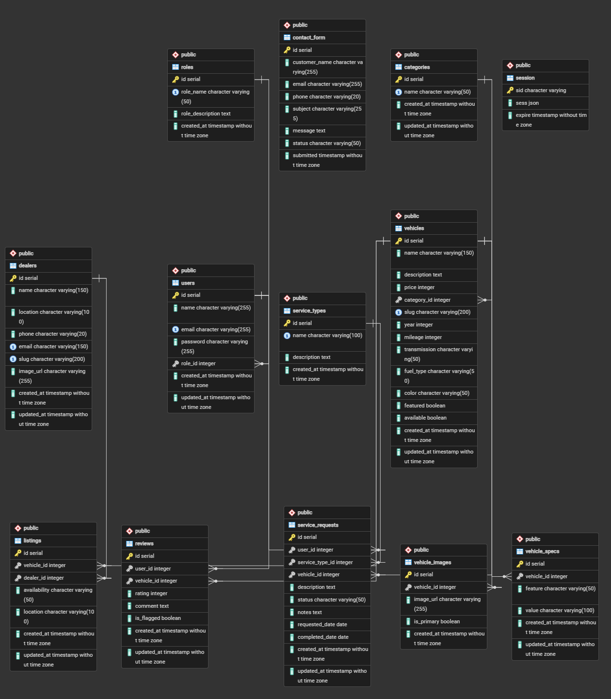

# ⚡ NeoMotor | Used Car Dealership

A full-stack, production-ready web application for a used car dealership. Built with modern Node.js (ESM), Express 5, EJS, and PostgreSQL (Neon). Users can browse inventory, leave reviews, manage favorites, track service requests, and compare vehicles side-by-side.

## 🛠️ Technology Stack

| Category | Technology |
|----------|------------|
| **Runtime & Framework** | Node.js (v20+), Express.js 5 |
| **Database** | PostgreSQL (hosted on [Neon](https://neon.tech)), `pg` (Pool) |
| **Templating** | EJS (Server-Side Rendering) |
| **Security** | Helmet, CSRF-Sync, Express-Rate-Limit, Bcrypt |
| **Validation** | Express-Validator |
| **Logging & Env** | Pino, Zod (Fail-fast environment validation) |
| **DevOps & Tooling**| Render (Deployment), ESLint, Prettier, pnpm |

## 🌐 Live Demo

> **URL:** [https://cse340-used-car-dealership-ym5u.onrender.com](https://cse340-used-car-dealership-ym5u.onrender.com)

## ✨ Features

### 🔐 Authentication & Authorization
- Secure registration and login using **Bcrypt** for password hashing.
- **Role-Based Access Control (RBAC)**: Customers, Employees, and Owners.
- Persistent session management with PostgreSQL (`connect-pg-simple`).
- **CSRF Protection** on all state-changing routes (POST/PUT/DELETE).
- **Rate Limiting** to prevent brute-force and spam attacks.

### 🚗 Vehicle Management
- Browse vehicles with search, category filters, and sorting.
- View detailed vehicle specifications and image galleries.
- Dealer inventory display.
- Side-by-side vehicle comparison (up to 3 vehicles).

### 📊 Dashboard Analytics
- **Customer:** Favorites count, reviews submitted, and service requests.
- **Employee:** Open inquiries, pending requests, and total vehicles.
- **Owner:** Global stats (Total users, vehicles, dealers, and reviews).

### 🌙 Modern UI & Accessibility (A11y)
- Dark/Light mode toggle with `localStorage` persistence (no flash of unstyled content).
- Fully responsive, mobile-first design with a **futuristic glassmorphism** aesthetic.
- **Accessible (A11y):** ARIA labels, semantic HTML, keyboard navigation for the mobile menu, and `aria-expanded` states.

## 🏗️ Architecture & Best Practices

This project was refactored from a university assignment into a production-grade application. Key architectural decisions include:

1. **Strict MVC Pattern**: Separation of concerns between Routes, Controllers, Models, and Views.
2. **Fail-Fast Environment**: The server won't start if critical `.env` variables are missing, thanks to `zod`.
3. **Centralized Error Handling**: A global error handler middleware catches both 404s and 500s, rendering safe, user-friendly error pages.
4. **Structured Logging**: Replaced `console.log` with `pino` for production-ready, structured HTTP and server logs.
5. **Database Safety**: The `setup.js` script verifies table existence before attempting to seed, preventing accidental data loss.

## 🗄️ Database Schema



*Entity-Relationship Diagram showing the database structure and relationships.*

### Core Tables
- `users` & `roles`: User accounts and permissions.
- `vehicles`, `categories`, `dealers`, `listings`: The core inventory system.
- `favorites`, `reviews`, `service_requests`: User interactions.
- `contact_form`, `notifications`: Support and user engagement.

## 👤 User Roles

| Role | Permissions |
|------|-------------|
| **Owner/Admin** | Full system control - manage users, vehicles, dealers, and all content. |
| **Employee** | Edit vehicles, moderate reviews, manage service requests, view inquiries. |
| **Customer** | Browse vehicles, leave reviews, submit requests, manage favorites. |

## 🚀 Installation & Setup

### Prerequisites
- Node.js (v20 or higher)
- [pnpm](https://pnpm.io/) (Package Manager)
- PostgreSQL Database (Local or [Neon](https://neon.tech) Cloud)

### Installation Steps

1. **Clone the repository**
   ```bash
   git clone https://github.com/jesustortoleroh/cse340-used-car-dealership.git
   cd cse340-used-car-dealership